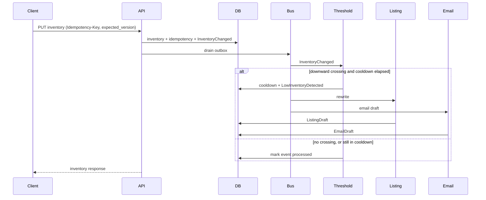

# CatalogGuard

Product catalog and per-store inventory for a multi-store retailer. When on-hand quantity for a SKU in a store crosses below its effective threshold, CatalogGuard stores a new SEO listing draft and queues a low-stock email draft. It does not change the live listing, and it does not send email. A separate one-shot worker records which queued drafts a downstream mailer may take, with suppressed customers removed.

## At a glance

**This is a portfolio service, not a deployed retailer system.** By default it runs on SQLite with a deterministic stub LLM, so it needs no API key.

What the demo shows:

- A low-stock inventory `PUT` stores a listing draft and a queued email draft. Live product SEO does not change, and no mail is sent.
- `POST /api/v1/listings/drafts/{id}/publish` copies a ready draft onto the store's live listing.
- `make handoff` records which queued drafts a mailer may take. It still sends nothing.

To try it, run these from the repository root (PowerShell shown):

1. `uv venv --python 3.12 .venv` (or `python -m venv .venv` with Python 3.12)
2. `uv pip install --python .venv -e ".[dev]"` (or `.\.venv\Scripts\python -m pip install -e ".[dev]"`)
3. `make seed`
4. `make run`
5. In a second terminal, follow the [curl walkthrough](#curl-walkthrough), then [hand the queued draft to a mailer](#hand-the-queued-draft-to-a-mailer).

The Makefile uses `.venv` when it exists, so activating the venv is optional. Without `make`, run the `python -m …` line from the matching Makefile target.

**Tests:** run `make test` and `make lint`. GitHub Actions runs the same checks on SQLite with the stub LLM.

**Limits:** Docker Compose describes the Postgres layout, but it has not been executed in CI. Two processes against one SQLite file are not supported.

Stack: Python 3.12, FastAPI, SQLAlchemy 2, Pydantic v2, SQLite by default, Postgres in Docker Compose. FastAPI fits this service: the work is an I/O-bound catalog API plus one LLM call, with a small domain that is easier to test outside the framework.

## Layout

```
src/catalogguard/
  domain/            entities, threshold and crossing rules, events
  application/       use cases, handlers, ports
  infrastructure/    SQLAlchemy, outbox bus, LLM providers, HTTP
prompts/             versioned prompt and email template files
adr/0001-kafka-event-bus.md
```

`domain/` does not import FastAPI, SQLAlchemy, or Pydantic. Application code depends on ports. Infrastructure implements them.

## Thresholds

Effective threshold for a (SKU, store) pair, most specific value that is defined:

1. `InventoryLevel.threshold_override` for that pair
2. `Product.threshold_override` for the SKU
3. `DEFAULT_LOW_STOCK_THRESHOLD` (default 5)

`None` means "not set". A stored `0` is set, and it wins over a broader value.

Low stock means `quantity < threshold`. Threshold 5 alerts at 4 or fewer. Quantity equal to the threshold does not.

## Low-inventory path



`EVENT_DISPATCH=inline` (the default) finishes that drain before the HTTP response returns, so a follow-up read sees the drafts. `EVENT_DISPATCH=async` schedules the drain on a background task in the same process. The outbox row is committed either way.

Listing rewrites are store-scoped. The handler inserts a `ListingDraft`. It does not write `Product` SEO fields. An operator publishes a ready draft with `POST /api/v1/listings/drafts/{id}/publish`. That writes `store_listings` for the SKU and store. A draft with status `validation_failed` is rejected. Publishing the same draft again with the live row's `expected_version` returns the current live row without a new version. With a different `expected_version` it is 409. Replacing it requires the live row's `expected_version`.

Every publish that stores a new live version also appends a row to `store_listing_revisions` in the same transaction. That row holds the stripped, customer-facing text that just went live, never the draft markers. `GET /api/v1/listings/{sku}/stores/{store_id}/revisions` lists them, newest version first.

`POST /api/v1/listings/{sku}/stores/{store_id}/rollback` with `{"revision_version": 1, "expected_version": 2}` republishes the draft behind that revision through the same publish step:

- The live version goes up, the text is stripped again, product SEO is untouched, and a new revision records it.
- If the revision is already live, it is 409 `That revision is already live`.
- A stale `expected_version` is 409 `optimistic_conflict`.
- A draft that no longer matches the product's attributes is 409 `conflict`, and the live row does not change.
- If there is no live row or no such revision, it is 404.

There is no unpublish and no delete of revisions. History starts with this feature: a listing published before revision `5751f906cab6` has a live row and no history until its next publish. Nothing is backfilled.

The email handler inserts one `EmailDraft` with status `queued`, including `quantity_as_of`. A quantity of 0 does not queue an "act now" draft. A downstream mailer owns delivery and must read stock again before sending, because the queued number can go stale.

### Crossing and cooldown

A low-stock event fires only on a downward crossing: previous quantity was at or above the threshold, and the new quantity is strictly below it.

- The first insert is not a crossing, even when the quantity is already low. Seed data can sit below threshold without creating drafts.
- Moving from 4 to 2 while the threshold is 5 is not a new crossing.
- After an event fires, another crossing for that (SKU, store) inside `LOW_STOCK_COOLDOWN_SECONDS` (default 24 hours) is dropped. It is not deferred.

Trade-off: a real restock-and-sellout inside the window is silent, and a crossing during the window is gone even if the item stays low. That stops a flapping count (5 → 4 → 6 → 4) from calling the model and queueing mail on every wobble. The manual rewrite endpoint is the operator path. Cooldown is judged from the event timestamp, so a redelivered inventory event does not extend the window or fire twice.

### Email targeting

This is a deliberate simplification. `RecentInteraction` stores `customer_id`, `sku`, `store_id`, `interaction_type` (`view` or `add_to_cart`), and `timestamp`. The handler loads rows for that SKU and store in the lookback window (`EMAIL_LOOKBACK_HOURS`, default 168), keeps one row per customer, and prefers `add_to_cart` over `view`. The payload carries opaque customer ids. This service does not resolve names or email addresses.

The email body is rendered from `prompts/email_urgency/v1.md`. It is not sent to the LLM, so customer ids never leave this database toward a model.

### Email handoff

CatalogGuard still sends nothing. `python -m catalogguard.mailer` (or `make handoff`) decides which queued drafts are ready for a downstream mailer and writes one `email_handoffs` row per draft. It runs one batch and exits. It is not a daemon. A scheduler such as cron or a Kubernetes CronJob can call it again.

Each run takes up to `EMAIL_HANDOFF_BATCH_SIZE` (default 50) drafts that are still `queued` and have no handoff row, oldest first. For each draft, in order:

1. Older than `EMAIL_HANDOFF_MAX_AGE_HOURS` (default 72, strictly greater): status `expired`. The payload names the draft id, SKU, and store and says it aged out. It carries no recipients.
2. Otherwise the draft payload is copied, and every recipient whose `customer_id` is in `email_suppressions` is removed. The removed ids go on `suppressed_customer_ids`. Matching is exact on the opaque id.
3. Nobody left, including a draft that never had recipients: status `suppressed`, `recipients` empty, subject and body kept, and a `handoff_note` that says why.
4. At least one recipient left: status `handed_off`. The payload keeps the draft fields (`subject`, `body`, `template_version`, `quantity_remaining`, `quantity_as_of`, `sku`, `store_id`, `store_name`, `product_name`, `targeting`, `targeting_note`), lists only the remaining recipients, and adds a `handoff_note` saying it was not sent.

The handoff row is the decision and the idempotency record. `email_draft_id` is unique. A second run skips drafts that already have a row. When two workers pick the same draft, the loser's insert hits the unique constraint inside a savepoint, the worker skips that draft, and the first decision stays as it was. A suppression added after a decision does not change that decision. The email draft itself stays `queued`, and a sold-out crossing that never created a draft never gets a handoff.

Suppressions are opaque customer ids (`^[A-Za-z0-9_.:-]{1,64}$`, so an email address is rejected) with a required reason of up to 200 characters. There is no delete endpoint yet.

The worker logs `email_handoff_recorded` with the draft id, SKU, store, status, remaining recipient count, and suppressed count. It never logs the ids. It increments `catalogguard_email_handoffs_total{result}` once per new decision (`handed_off`, `suppressed`, `expired`). That counter lives in the worker process, which exits after one batch, so the API's `/metrics` does not show it. Read the JSON summary that the worker prints as its last line, or count `email_handoffs` rows.

On SQLite the worker creates missing tables first, like the API. On Postgres it relies on Alembic, so run `make migrate` first. The drain worker (`make drain`, below) follows the same rule.

### Listing guardrail

`prompts/listing_rewrite/v1.md` is the prompt. Every draft stores `prompt_version` (`listing_rewrite/v1`) and the model name.

The model must return JSON. The service checks:

- required fields are present and non-empty
- title ≤ 70 characters, meta description ≤ 160, plus the other limits in `domain/listing_rules.py`
- every `cited_attributes` entry exists on the product
- every cited key appears in the copy as `[[key]]`
- the attribute's value appears as its own token

Violations are stored on the draft with status `validation_failed`. The draft is not treated as ready. Each `[[key]]` must have that attribute's value in the 48 characters just before the marker, so a value that only appears in the product name does not satisfy a citation. This is still not a proof that free prose is entailed by the catalog. Uncited claims can slip through. The cases in `evals/listing_guardrail.json` lock those rules.

Drafts keep the markers. Publish copies the text onto `store_listings` with the markers removed, after checking the draft against the product attributes as they are now. A catalog edit between generation and publish blocks publish. `X-Correlation-ID` longer than 64 characters is rejected, because that is the column width on Postgres.

Each SKU may spend `LLM_DAILY_CAP_PER_SKU` generations per UTC day (default 24). `0` turns the cap off. The reservation is counted before the provider is called, including retries, so a failing call still spends budget. A manual rewrite over the cap returns 429 `llm_cost_limit`. The low-stock handler records a dead letter and still queues the email draft. The counter is `catalogguard_listing_rewrites_total{result="cost_limited"}`.

The default provider is a deterministic stub (`stub-deterministic-v1`) so the service runs with no API key. Set `LLM_PROVIDER=openai` to call an OpenAI-compatible Chat Completions endpoint. The default base URL is SpaceXAI, `https://api.x.ai/v1`, model `grok-4.7`, using `response_format.type = json_schema`. Point `LLM_BASE_URL` at any compatible server. The key is `LLM_API_KEY` or `XAI_API_KEY`.

## Run locally

```powershell
uv venv --python 3.12 .venv
.\.venv\Scripts\Activate.ps1
uv pip install --python .venv -e ".[dev]"
copy .env.example .env
make seed
make run
```

`make test` and `make lint` use `.venv` when it exists. OpenAPI is at <http://127.0.0.1:8000/docs>.

Postgres:

```powershell
docker compose up --build
```

Compose starts Postgres and the API, with `SEED_ON_STARTUP=true` and the stub provider. The same curls below work against `http://127.0.0.1:8000`. `docker compose down -v` drops the database volume.

## Curl walkthrough

Assumes a fresh seed. `BKPK-28L-OLV` at `nyc` starts at quantity 12, version 1. The global threshold is 5. Four seeded customers interacted with that pack in New York. `cus_1009` viewed it in Chicago and must not appear on the New York draft.

`curl.exe` avoids PowerShell's `curl` alias. PowerShell 5.1 strips quotes before they reach native programs, so each PUT uses `--%`, which stops that parsing. Bash users should skip `--%` and pass the body in single quotes: `--data-raw '{"quantity":2,"expected_version":1}'`.

```powershell
curl.exe -s http://127.0.0.1:8000/health

curl.exe -s http://127.0.0.1:8000/api/v1/thresholds/BKPK-28L-OLV/nyc
curl.exe -s http://127.0.0.1:8000/api/v1/thresholds/BLKT-WOL-QUE/nyc
curl.exe -s http://127.0.0.1:8000/api/v1/thresholds/BLKT-WOL-QUE/aus

curl.exe -s http://127.0.0.1:8000/api/v1/inventory/BKPK-28L-OLV/nyc

curl.exe -s -D - --% -X PUT "http://127.0.0.1:8000/api/v1/inventory/BKPK-28L-OLV/nyc" -H "Content-Type: application/json" -H "Idempotency-Key: walkthrough-bkpk-nyc-1" -H "X-Correlation-ID: walkthrough-1" --data-raw "{\"quantity\":2,\"expected_version\":1}"

curl.exe -s "http://127.0.0.1:8000/api/v1/listings/drafts?sku=BKPK-28L-OLV&store_id=nyc"

curl.exe -s "http://127.0.0.1:8000/api/v1/email-drafts?sku=BKPK-28L-OLV&store_id=nyc"

curl.exe -s -D - --% -X PUT "http://127.0.0.1:8000/api/v1/inventory/BKPK-28L-OLV/nyc" -H "Content-Type: application/json" -H "Idempotency-Key: walkthrough-bkpk-nyc-1" --data-raw "{\"quantity\":2,\"expected_version\":1}"

curl.exe -s http://127.0.0.1:8000/metrics
```

Publish the draft that the crossing just stored. This uses `Invoke-RestMethod` so the draft id does not have to be pasted by hand:

```powershell
$drafts = Invoke-RestMethod "http://127.0.0.1:8000/api/v1/listings/drafts?sku=BKPK-28L-OLV&store_id=nyc"
Invoke-RestMethod -Method Post -Uri "http://127.0.0.1:8000/api/v1/listings/drafts/$($drafts.items[0].id)/publish" -ContentType "application/json" -Body '{"expected_version":0}'
Invoke-RestMethod "http://127.0.0.1:8000/api/v1/listings/BKPK-28L-OLV/stores/nyc"
```

The live title matches the draft. `GET /api/v1/products/BKPK-28L-OLV` still shows the seeded SEO fields.

What you should see:

- Threshold sources: `global` 5 for the pack in New York, `sku` 8 for the wool blanket in New York, `sku_store` 3 for that blanket in Austin.
- The PUT returns quantity 2, previous quantity 12, version 2, and echoes `X-Correlation-ID: walkthrough-1`.
- One listing draft, `status` `ready`, `prompt_version` `listing_rewrite/v1`, `model` `stub-deterministic-v1`, empty `violations`. The title starts with `Fieldwork Supply Trailhead 28 Pack`. The product's live SEO fields are unchanged.
- One email draft, `status` `queued`, subject `Only 2 left in Hudson Market — act now`, recipients `cus_1842` (`add_to_cart`), `cus_4410`, `cus_7781`, and `cus_9021`. Not `cus_1009`.
- The second PUT returns the same body and `Idempotency-Replayed: true`. Draft counts stay at one.
- `/metrics` includes `catalogguard_events_emitted_total`, `catalogguard_listing_rewrites_total`, and `catalogguard_llm_latency_seconds`.

A manual rewrite, which does not queue email:

```powershell
curl.exe -s -X POST "http://127.0.0.1:8000/api/v1/listings/LANT-LED-01/stores/nyc/rewrite"
```

If this database was already walked through, `expected_version` is no longer 1 and the pack may already be below the threshold. Either delete `catalogguard.db` and run `make seed` again, or read the version and cross again with a new idempotency key:

```powershell
curl.exe -s -D - --% -X PUT "http://127.0.0.1:8000/api/v1/inventory/BKPK-28L-OLV/nyc" -H "Content-Type: application/json" -H "Idempotency-Key: walkthrough-bkpk-nyc-restock" --data-raw "{\"quantity\":12,\"expected_version\":2}"

curl.exe -s -D - --% -X PUT "http://127.0.0.1:8000/api/v1/inventory/BKPK-28L-OLV/nyc" -H "Content-Type: application/json" -H "Idempotency-Key: walkthrough-bkpk-nyc-2" --data-raw "{\"quantity\":2,\"expected_version\":3}"
```

Seed is idempotent and will not reset a quantity that is already stored. A second `make seed` does not rewind the demo.

### Hand the queued draft to a mailer

This assumes the walkthrough above has already queued the New York draft, and that nobody is suppressed. Keep the API running. Run the worker from a second terminal in the repository root:

```powershell
make handoff
curl.exe -s "http://127.0.0.1:8000/api/v1/email-handoffs?sku=BKPK-28L-OLV&store_id=nyc"
make handoff
```

Without `make`, run `.\.venv\Scripts\python.exe -m catalogguard.mailer` instead. The worker writes JSON log lines to stderr and a summary to stdout.

What you should see:

- The first run prints `{"examined": 1, "handed_off": 1, "suppressed": 0, "expired": 0, "skipped": 0}`.
- The GET returns one handoff with status `handed_off`, recipients `cus_1842`, `cus_4410`, `cus_7781`, and `cus_9021`, an empty `suppressed_customer_ids`, the draft's `quantity_as_of`, and a `handoff_note`.
- The second run prints `"examined": 0`. Nothing new is recorded.
- `GET /api/v1/email-drafts?sku=BKPK-28L-OLV&store_id=nyc` still shows the draft as `queued`.

Nothing was delivered. No email was sent and no mail provider was called. The handoff row is a record for a mailer that does not exist in this repository.

To see suppression, start from a fresh seed (delete `catalogguard.db`, then `make seed` and `make run`). Suppress a customer before the first crossing PUT, then run the walkthrough PUT and `make handoff`. `cus_1842` is then missing from `recipients` and listed in `suppressed_customer_ids`:

```powershell
curl.exe -s --% -X POST "http://127.0.0.1:8000/api/v1/email-suppressions" -H "Content-Type: application/json" --data-raw "{\"customer_id\":\"cus_1842\",\"reason\":\"unsubscribed\"}"
```

A suppression added after a draft was already decided does not change that decision. Because of the 24-hour cooldown, a second crossing for the same pack and store will not queue a new draft the same day.

## API

| Method | Path | Role |
| --- | --- | --- |
| GET | `/health`, `/metrics` | Process health and Prometheus counters |
| POST/GET/PATCH/DELETE | `/api/v1/products` | Product catalog. Delete is rejected while inventory or other rows reference the SKU |
| POST/GET | `/api/v1/stores` | Stores |
| PUT | `/api/v1/inventory/{sku}/{store_id}` | Set quantity. Requires `Idempotency-Key` and `expected_version` (`0` creates the row) |
| GET | `/api/v1/inventory`, `/api/v1/inventory/{sku}/{store_id}` | Read on-hand quantity and version |
| GET | `/api/v1/inventory/{sku}/{store_id}/changes` | Quantity and threshold history for that pair, newest first. Paginated. 404 for an unknown product or store |
| GET | `/api/v1/thresholds/{sku}/{store_id}` | Effective threshold and which level supplied it |
| POST | `/api/v1/listings/{sku}/stores/{store_id}/rewrite` | Manual listing draft. Does not queue email |
| GET | `/api/v1/listings/drafts` | Listing drafts |
| POST | `/api/v1/listings/drafts/{id}/publish` | Copy a ready draft onto the live store listing. `expected_version` 0 creates it |
| GET | `/api/v1/listings/{sku}/stores/{store_id}` | Live store listing |
| GET | `/api/v1/listings/{sku}/stores/{store_id}/revisions` | Live listing history, newest version first. Paginated |
| POST | `/api/v1/listings/{sku}/stores/{store_id}/rollback` | Republish an earlier revision through publish. Body `revision_version`, `expected_version` |
| GET | `/api/v1/outbox/summary` | Unpublished rows, live leases, and the oldest unpublished age in seconds |
| GET | `/api/v1/email-drafts` | Queued email drafts |
| POST/GET | `/api/v1/email-suppressions` | Suppress an opaque customer id (`customer_id`, `reason`). Duplicate is 409. GET is paginated |
| GET | `/api/v1/email-handoffs` | Handoff decisions. Filters `status`, `sku`, `store_id`, plus `limit` and `offset`. There is no send route |
| GET | `/api/v1/dead-letters` | Handlers that exhausted retries, with `redrive_count`, `last_redrive_status`, and `last_redriven_at` |
| POST | `/api/v1/dead-letters/{id}/redrive` | Run only that letter's handler on its stored event. No body. The letter is kept. `outbox_decode` is 409. Nothing is sent |

Inventory conflicts:

- `409` `optimistic_conflict` with `current_version` when `expected_version` does not match
- `409` `idempotency_conflict` when the key was already used with a different body
- The same key and the same body return the original response and `Idempotency-Replayed: true`

Omit `threshold_override` to leave the current override alone. Send `null` to clear it.

Inventory history (`GET /api/v1/inventory/{sku}/{store_id}/changes`) is append-only. A row is written in the same transaction as the stock row, only when quantity or the threshold override actually changes, and it carries the same `event_id` as that write's `InventoryChanged`. Replays, no-op writes, and rejected writes add nothing. History is not backfilled: changes made before revision `89e567ee29fd`, and seeded stock, have no rows.

## Configuration

See `.env.example`. Defaults: SQLite file `catalogguard.db`, stub LLM, inline dispatch, threshold 5, cooldown 24 hours, 24 LLM calls per SKU per UTC day, outbox lease 300 seconds renewed every 60 seconds while a drain is alive, three handler attempts, three LLM transport attempts, email handoff batch 50, and handoff max age 72 hours.

`LLM_PROVIDER=openai` without `LLM_API_KEY` or `XAI_API_KEY` fails at startup.

## Production notes

**Scaling.** SQLite is the dev default. Do not run two writers against one SQLite file. That means two API processes, or the API plus `make drain`. Postgres is the database when more than one process drains the outbox.

- **Leases.** The drain leases each batch before dispatch. On Postgres that lease is `SELECT … FOR UPDATE SKIP LOCKED`, and `mark_published` only succeeds for the token that holds the lease. A lease older than `OUTBOX_CLAIM_TIMEOUT_SECONDS` (300) can be taken again. The low-stock event id is derived from the inventory event id, so two drainers cannot insert two downstream events for one write.
- **Renewal.** While a batch runs, a keeper task renews its lease every `OUTBOX_LEASE_RENEW_SECONDS` (60), so a slow model call no longer lets another worker take rows that are still being worked on. The renew interval must be greater than 0 and less than the claim timeout, or the API and the drain worker refuse to start.
- **Idle versus lost.** A renewal that finds nothing left under its token is **idle**, the normal end of a batch, and the keeper stops quietly. A renewal that finds an unpublished row from its batch under another token, or under none, is **lost**. The keeper then counts `catalogguard_outbox_lease_lost_total` once and logs `outbox_lease_lost` with the token. This worker dispatches nothing more from that batch and does not mark the in-flight row published. A lost lease is not a drain failure and writes no dead letter. Handlers stay idempotent, so the new owner can run them again. A lease left to expire without renewal is still reclaimable after the timeout.
- **In one process.** The asyncio lock only stops a single process from draining itself twice. Listing and email workers that should run outside the API still belong on Kafka.

**Draining without the API.** `python -m catalogguard.drain` (or `make drain`) builds the same handlers and bus as the API, drains inline until no claimable row is left, prints `{"unpublished_before": N, "unpublished_after": M}` as its last stdout line, and exits. It always drains inline, even when `EVENT_DISPATCH=async`. It is not a daemon; a scheduler can call it again. Use it when the API runs `EVENT_DISPATCH=async`, or after a crash left unpublished rows. On SQLite it creates missing tables first. On Postgres it relies on Alembic. Compose stays on inline dispatch.

**Backlog.** `GET /api/v1/outbox/summary` returns:

- `unpublished`: rows not yet published.
- `claimed`: unpublished rows whose lease is still inside the timeout. An expired lease counts as unpublished and not claimed.
- `oldest_unpublished_age_seconds`: whole seconds since the oldest unpublished row was created, or `null` when there are none.

It reads the database with the injected clock, so it does not depend on which process drained last. The gauges `catalogguard_outbox_unpublished` and `catalogguard_outbox_oldest_unpublished_seconds` (0 when nothing is pending) are set at the end of each drain in the API process and whenever the summary is read. The drain worker's gauges disappear when that process exits, so use the summary endpoint for the current backlog.

```powershell
make drain
curl.exe -s http://127.0.0.1:8000/api/v1/outbox/summary
```

Inline dispatch holds a process-wide lock until the outbox is empty. A stock update for an unrelated SKU waits behind an in-flight model call. That is acceptable for the demo and a poor fit for a burst of store updates. `EVENT_DISPATCH=async` returns after scheduling the drain, and `make drain` can finish what a background drain left behind. Compose still uses inline so the curl walkthrough can read drafts immediately.

Inline dispatch keeps the request open for the LLM call. That is the right demo default and a poor fit once rewrite latency matters. `EVENT_DISPATCH=async` only moves the drain onto a background task. It does not make the drain safe across instances.

**Idempotency.** The inventory write, the idempotency record, and the `InventoryChanged` outbox row commit in one transaction. A client retry with the same key returns the stored response and does not apply the write again. If the process dies after that commit and before the drain, the next request's drain (and the drain on startup) delivers the unpublished row. Handlers are safe to run again: threshold evaluation records `processed_events` in the same transaction as the downstream outbox row, listing drafts are unique on `trigger_event_id`, and email drafts are unique on `dedupe_key`.

**Failure modes.** A listing or email failure does not roll back the stock count. Malformed model output is retried, then written to `dead_letters`. A validation failure is deterministic, so it is stored on the draft and not retried. The email handler still runs if the listing handler fails. A crossing inside the cooldown is discarded. Permanent LLM errors (for example HTTP 400) are not retried inside the provider. Transport errors and HTTP 429/5xx are.

**Recovering a dead letter.** `POST /api/v1/dead-letters/{id}/redrive` takes no body and runs only that letter's handler (`threshold_evaluation`, `listing_rewrite`, or `email_draft`) once, on the event stored with the letter.

- **Scope.** It does not go back through the outbox, so the other subscribers for that event do not run again. It does not retry, and it never writes a new dead letter.
- **The letter.** It is kept. Each attempt is a row in `dead_letter_redrives`, and `GET /api/v1/dead-letters` shows `redrive_count`, `last_redrive_status`, and `last_redriven_at`.
- **After a success.** A second POST returns `"result": "replayed"` without running the handler.
- **After a failure.** The handler's error keeps its usual status (429 `llm_cost_limit`, 404, 502 `malformed_llm_output`, or 500). It is recorded as `failed`, and a later POST can try again.
- **Threshold letters.** A threshold redrive writes `LowInventoryDetected` and then drains once, so the listing and email drafts exist when it returns. If that drain fails, the redrive still returns success and the failure is logged.
- **Listing letters.** A listing redrive goes through the normal daily LLM cap. It spends one call when no draft exists yet for that trigger. It spends nothing, and returns the existing draft, when one does.
- **Email letters.** A recovered email draft is `queued` like any other, and a sold-out event still queues none. Nothing is sent, and no handoff is recorded until the handoff worker runs.
- **Refusals.** An `outbox_decode` letter returns 409 `Undecodable outbox rows cannot be redriven`, and the row is not put back on the outbox. A payload that no longer decodes, or a handler name that is not registered, is also 409. None of these refusals records an attempt.

`catalogguard_dead_letter_redrives_total{result}` counts `succeeded`, `failed`, `rejected` (the refusals and unknown ids), and `replayed`. A redrive never increments `catalogguard_dead_letters_total`.

```powershell
curl.exe -s "http://127.0.0.1:8000/api/v1/dead-letters"
curl.exe -s -X POST "http://127.0.0.1:8000/api/v1/dead-letters/<dead-letter-id>/redrive"
```

**Inventory versus listing consistency.** The stock row is the source of truth for quantity. Listing copy is a proposal in `listing_drafts`. Those writes are separate transactions on purpose: a model outage must not block a stock update, and a draft must not change what the storefront shows until someone accepts it. Readers can observe a new quantity before a draft exists when dispatch is async, or when the handler is still retrying. They must not assume the live SEO fields moved. They did not.

**Optimistic locking.** `InventoryLevel.version` starts at 1. The client sends `expected_version`. The update is a compare-and-set. A mismatch returns 409 and the current version. The caller re-reads and retries with a new idempotency key if the body changed. Two workers cannot both apply a stale quantity.

**LLM cost.** The stub is the default. A real call happens only on a downward crossing outside the cooldown, on a manual rewrite, and only while the SKU is under `LLM_DAILY_CAP_PER_SKU`. The cap is per SKU per UTC day and is shared by every store. Retries spend the same budget. Validation failures are not retried after a parse succeeds. Prompts are versioned, so a prompt edit does not silently rewrite history. Structured output (`json_schema`, strict) is requested so fewer calls die in the parser. Lower the cap before pointing a busy catalog at a paid model.

**PII.** Email drafts store customer ids, not addresses, names, or message bodies personalized with contact data. Logs record a recipient count. The listing prompt contains the product and the store only. The handoff worker removes ids on `email_suppressions` before a mailer sees them, and logs counts, not ids. The mailer that later joins these ids to a CRM still has to apply access control, retention, and its own delivery-time suppression, such as bounces or a CRM opt-out that never reached this table. Do not log the draft or handoff payload.

**Kafka and more than one instance.** Keep writing the outbox in the state-change transaction. The API drain already claims rows. The next move is a publisher that produces leased rows to `catalogguard.events` with key `{sku}|{store_id}`, then marks `published_at`. Run listing rewrite and email drafts as consumers when that work should leave the API process. The skeleton is `KafkaEventBus` in `infrastructure/events/kafka.py`. It raises if called. The swap is described in `adr/0001-kafka-event-bus.md`. SQS is the same shape with a visibility timeout and a dead-letter queue.

**Migrations.** Local SQLite and the test suite create tables with `metadata.create_all` on startup. The API does that only when `DATABASE_URL` is SQLite. Postgres does not run `create_all`, so a new table or column has to be in an Alembic revision or it will be missing in Docker. Docker runs `python -m catalogguard.migrate` (`alembic upgrade head`) before the API listens. `make migrate` does the same against `DATABASE_URL`. Run that once per deploy, not inside every replica if more than one container starts together. Revision `15e685dc71f6` (`email_handoff`) adds `email_suppressions` and `email_handoffs` on top of the initial schema. Revision `c81f0f63dcdc` (`dead_letter_redrive`) adds `dead_letter_redrives` on top of that. Revision `5751f906cab6` (`store_listing_revisions`) adds `store_listing_revisions` on top of that. Revision `89e567ee29fd` (`inventory_changes`) adds `inventory_changes` on top of that. The lease renewal needs no schema change. A SQLite file created before `store_listings`, `llm_usage`, or `claimed_at` existed will not pick up those columns from `create_all`. Delete `catalogguard.db` and run `make seed`, or start from an empty database and run `make migrate`.

## Tests

`make test` covers threshold resolution, crossing edges, cooldown, flapping, optimistic concurrency, idempotent inventory updates, event-bus retry and dead letter, outbox leases, listing generation (stub, malformed output, validation failure), the guardrail eval file, publish, the daily LLM cap, an Alembic upgrade, and an API test of the full low-inventory path. `tests/integration/test_email_handoff.py` covers the handoff worker: New York recipients, one suppressed customer, all suppressed, a draft with no recipients, expiry and its boundary, the sold-out skip, oldest-first batching, filters, a second run, a lost race that must not overwrite, duplicate suppressions, and the `python -m catalogguard.mailer` entry point on a fresh database.

`tests/integration/test_dead_letter_redrive.py` covers the redrive endpoint:

- recovering malformed model output, then replaying without calling the handler or the model
- concurrent POSTs
- the daily cap: 429 on the same UTC day, success the next day
- refusing `outbox_decode`, unknown ids, undecodable payloads, and unregistered handlers
- email recovery that keeps one listing draft and one queued email
- threshold recovery that drains into both drafts without a handoff
- a drain failure after a successful redrive
- a failed attempt, truncated to 2000 characters, followed by a successful retry

`tests/integration/test_outbox_lease.py` covers the outbox lease, the drain worker, and the backlog:

- renewal, idle after publish, and a stolen lease that is lost
- the keeper renewing during an in-flight handler
- a lost batch that stops without publishing or dead-lettering
- the async API leaving rows that `python -m catalogguard.drain` publishes
- the inline API still having drafts when the PUT returns
- the drain command on a fresh database
- the summary counts and gauges
- the startup check on the renew interval

`tests/integration/test_listing_revisions.py` covers listing history:

- stripped revisions on publish, and no revision on a repeat publish
- rollback through publish
- rolling back to the live version, with a stale version, or to a draft that no longer matches the product
- the 404 cases

`tests/integration/test_inventory_changes.py` covers inventory history:

- one row per real change (create, quantity, threshold set, threshold cleared), with nothing added for no-op writes, replays, a stale version, or an unknown store
- matching `event_id` and `occurred_at` with the outbox event
- newest-first pagination
- 404s versus an empty page for a pair never stocked
- no history from the seed

`make lint` runs Ruff. `.github/workflows/ci.yml` runs `ruff check`, `ruff format --check`, and `pytest -q` on Ubuntu with Python 3.12 for pushes and pull requests to `main`. It needs no Postgres, Docker, or secrets.

## What this service does not do

Authentication, email delivery, a UI, multi-tenancy beyond the store model, payments, and carts. The email handoff records a decision for a mailer. It does not deliver anything. `RecentInteraction` is seeded. Publishing a draft updates the store listing inside this service. It does not push that copy to an external storefront.

## License

MIT. See [LICENSE](LICENSE).
