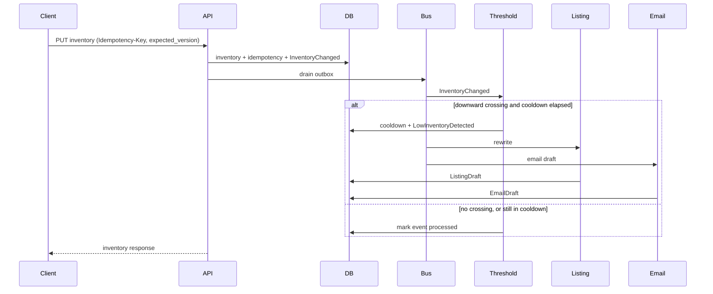

# CatalogGuard

[](https://github.com/KiranKri/CatalogGuard/actions/workflows/ci.yml)

CatalogGuard shows how to make a workflow that calls an AI model safe to retry, safe to crash, safe on a budget, and safe to run on several workers. When a store's stock drops below its threshold, it stores a fact-checked listing draft and queues an email draft. Nothing goes live or gets sent without a separate decision.

AI coding assistants wrote the code under the author's direction; the author set the rules each change had to meet and reviewed the result.

## Controls

| Control | Where | Proof |
| --- | --- | --- |
| Idempotent write | `src/catalogguard/application/inventory.py` (`InventoryService.upsert`) | `tests/unit/test_idempotency.py` |
| Optimistic concurrency | same file, the version compare-and-set in `InventoryService._apply` | `tests/unit/test_concurrency.py` |
| Outbox and lease | `src/catalogguard/infrastructure/events/bus.py` (`InProcessEventBus`) | `tests/integration/test_outbox_lease.py`, `tests/unit/test_outbox_claim.py` |
| Guarded model output | `src/catalogguard/application/listing_validation.py` (`validate_listing`) | `tests/unit/test_listing_validation.py`, `tests/unit/test_listing_eval.py`, `evals/listing_guardrail.json` |
| Cost cap | `src/catalogguard/application/listing.py` (`ListingService._reserve_llm_call`) | `tests/unit/test_cost_cap.py` |
| Crossing and cooldown | `src/catalogguard/domain/crossing.py` | `tests/unit/test_crossing.py`, `tests/unit/test_flapping.py`, `tests/integration/test_suppressed_crossings.py` |
| Recovery | `src/catalogguard/application/redrive.py` | `tests/integration/test_dead_letter_redrive.py` |

### Decisions

- Quantity is an absolute set with `expected_version`, because two writers must never both apply a delta. The loser gets 409 and `current_version`.
- The outbox row commits in the same transaction as the stock change, so a crash cannot leave a new quantity with no event.
- A crossing inside the cooldown is stored and dropped, not deferred, so a flapping count does not rewrite the listing on every wobble.
- Low stock stores a draft. The email carries the urgency. The listing draft is a proposed refresh of the product story, and the model is not told the stock level, so it cannot invent scarcity. A store's live listing changes only when an operator publishes that draft, and the model path never writes the product's own SEO fields.
- Every `[[key]]` must name a real attribute, with that attribute's value in the 48 characters before the marker. Uncited prose can still slip through.
- The LLM cap is per SKU per UTC day, shared by every store, and counted before the provider call. There is no global budget.
- SQLite is the default so the demo needs no Docker. Two processes against one SQLite file are not supported.

### Not built on purpose

No login, no UI, no SMTP, and no Kafka client. The in-repo Kafka adapter, `KafkaEventBus`, raises if called. See [What this service does not do](#what-this-service-does-not-do).

## Status and limits

**This is a portfolio service, not a deployed retailer system.** By default it runs on SQLite with a deterministic stub LLM, so it needs no API key.

What the demo shows:

- A low-stock inventory `PUT` stores a listing draft and a queued email draft. Live product SEO does not change, and no mail is sent.
- `POST /api/v1/listings/drafts/{id}/publish` copies a ready draft onto the store's live listing.
- `make handoff` records which queued drafts a mailer may take. It still sends nothing.

**Tests:** run `make test` and `make lint`. GitHub Actions run [39130397208](https://github.com/KiranKri/CatalogGuard/actions/runs/39130397208) passed three jobs: SQLite lint and tests, the suite on Postgres 16, and a Docker Compose smoke of the walkthrough plus the mailer.

**Limits:** Proven there: the test suite, the two-engine `SKIP LOCKED` claim test and the two-engine redrive-claim test on Postgres 16, and Compose starting the API, serving the crossing walkthrough, and handing off one email draft. Not proven: load, a redrive whose process dies mid-handler (the claim can be taken over and spend a second model call), and `python -m catalogguard.drain` against Postgres. That command's fresh-database test is SQLite-only, and the smoke job runs the mailer, not the drain. Two processes against one SQLite file are still not supported.

Stack: Python 3.12, FastAPI, SQLAlchemy 2, Pydantic v2, SQLite by default, Postgres in Docker Compose. FastAPI fits this service: the work is an I/O-bound catalog API plus one LLM call, with a small domain that is easier to test outside the framework.

## Low-inventory path



The rules under that diagram are in [Behavior](docs/behavior.md).

## Quickstart

From the repository root. `uv` is optional. The Makefile uses `.venv` when it exists.

```bash
python3.12 -m venv .venv
.venv/bin/pip install -e ".[dev]"
make seed
make run
make test
```

<details>
<summary>Windows PowerShell</summary>

```powershell
uv venv --python 3.12 .venv
.\.venv\Scripts\Activate.ps1
uv pip install --python .venv -e ".[dev]"
copy .env.example .env
make seed
make run
```

Or `python -m venv .venv` with Python 3.12, then `.\.venv\Scripts\python -m pip install -e ".[dev]"`. Without `make`, run the `python -m …` line from the matching Makefile target.

</details>

## Try it

- [Curl walkthrough](docs/walkthrough.md), from a fresh seed through publish and handoff.
- [The cap, a dead letter, and a redrive](docs/walkthrough.md#walkthrough-continued-the-cap-a-dead-letter-and-a-redrive), a second run that shows a failure and its recovery.

## Layout

```
src/catalogguard/
  domain/            entities, threshold and crossing rules, events
  application/       use cases, handlers, ports
  infrastructure/    SQLAlchemy, outbox bus, LLM providers, HTTP
prompts/             versioned prompt and email template files
adr/0001-kafka-event-bus.md
docs/                behavior, API, operations, walkthrough, tests
```

`domain/` does not import FastAPI, SQLAlchemy, or Pydantic. Application code depends on ports. Infrastructure implements them.

More detail: [behavior](docs/behavior.md), [API](docs/api.md), [operations](docs/operations.md), [tests](docs/testing.md).

## What this service does not do

Authentication, email delivery (no SMTP), a UI, a Kafka client, multi-tenancy beyond the store model, payments, and carts. `KafkaEventBus` is a skeleton that raises if called. The email handoff records a decision for a mailer. It does not deliver anything. `RecentInteraction` is seeded. Publishing a draft updates the store listing inside this service. It does not push that copy to an external storefront.

## License

MIT, on purpose. The engine is meant to be read, run, and built on. See [LICENSE](LICENSE).
